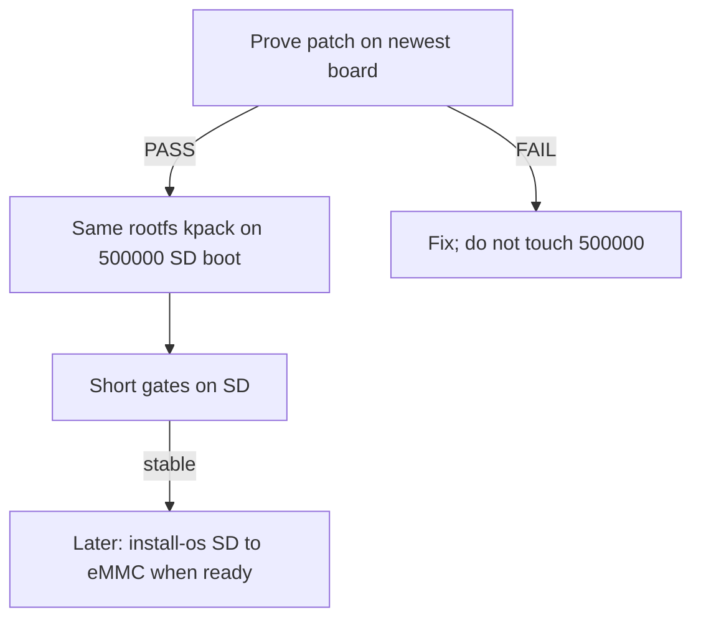

# Prove-then-patch (500000 board still on SD)

**Facts:**
- Patches / rootfs kpacks are OK once proven.
- Full blank-slate image rewrite is deferred.
- The **older 500000 board is not on eMMC yet** — it still boots from **SD**.
  So eMMC recovery / `install-os sd-to-emmc` is a **later** commissioning step,
  not the next patch risk.

**Allowed now:** rootfs/kernel kpack on SD-rooted system (and on newest board).  
**Not yet on 500000:** U-Boot kpack, eMMC wipe/install, recovery latch drills.



---

## What “works” means in this phase

| Goal | Newest board | 500000 (SD) board |
|------|--------------|-------------------|
| New fram-service / layout v4 / config | Prove here first | Same kpack onto **SD rootfs** |
| Boot survives patch | Required | Required (still from SD) |
| Automatic eMMC recovery | Nice-to-have dry-run later | **N/A until eMMC is populated** |
| U-Boot 115200 + recovery | Later Phase 3 | Later; old U-Boot stays 500000 for now |

---

## Unstable serial (500000)

- One command per paste; wait for a real prompt.
- Short queries only (`fram-get boot_media`, tiny `curl`) — never bare `fram-get`.
- Prefer Ethernet if available.
- Baud: U-Boot **500000**; after Linux getty on a 115200 rootfs, switch host to **115200**.

Confirm it is still SD-rooted before patching:

```sh
awk '$2=="/"{print}' /proc/mounts
```

```sh
for d in /sys/block/mmcblk*; do [ -d "$d" ] || continue; n=${d##*/}; case $n in *boot*|*rpmb*) continue;; esac; echo $n $(cat $d/device/type 2>/dev/null); done
```

Root on an `SD` device → stay in “SD commissioning” mode. Do **not** run
`install-os sd-to-emmc` until you intentionally move flight to eMMC.

---

## Stage 0 — Build candidate

```sh
./tools/package-kpack-phases.sh
# deploy/kpack-phases/kpack-rootfs.itb  — record SHA256
```

Same ITB SHA for newest board, then 500000 SD board.

---

## Stage 1 — Newest board (mandatory prove)

### 1A. Baseline

```sh
curl -s http://127.0.0.1:8091/ -H 'Content-Type: application/json' -d '{"query":"{ memoryMap { layoutVersion } }"}'
```

```sh
fw_printenv bootcmd 2>/dev/null || true
```

```sh
awk '$2=="/"{print}' /proc/mounts
```

### 1B. Apply rootfs-only kpack → reboot

### 1C. Post-patch gates (all green or stop)

```sh
curl -s http://127.0.0.1:8091/ -H 'Content-Type: application/json' -d '{"query":"{ memoryMap { layoutVersion } }"}'
```

```sh
curl -s http://127.0.0.1:8091/ -H 'Content-Type: application/json' -d '{"query":"{ missionState { totalBootFails emmcRecoveryNeeded bootMedia bootImageId } }"}'
```

```sh
fw_printenv bootcmd
```

```sh
ls /usr/sbin/install-os /etc/init.d/S92radsat-boot-stamp 2>&1
```

```sh
grep -E '^\[(fram-service|mram-service|comms-services|snn-service)' /etc/kubos-config.toml
```

**PASS** = boots, GraphQL OK, expected layout/tools/config, no surprise NFS `bootcmd` you did not plan for.

---

## Stage 2 — 500000 board on SD (only after Stage 1 PASS)

### 2A. Pre-flight (read-only)

```sh
awk '$2=="/"{print}' /proc/mounts
```

```sh
fw_printenv bootcmd
```

```sh
curl -s http://127.0.0.1:8091/ -H 'Content-Type: application/json' -d '{"query":"{ memoryMap { layoutVersion } }"}'
```

Expect: root on **SD**. If fram is ancient, `layoutVersion` may be missing/old — that is why you are patching.

### 2B. Same `kpack-rootfs.itb` onto the **SD** system

- Rootfs-only apply (updates the live SD rootfs / whatever your kpack path writes).
- **No** `kpack-uboot`, **no** `install-os sd-to-emmc`.
- Reboot with baud handoff; re-check Stage 1C shorts.

### 2C. PASS on SD

- Same layout/tools behavior as newest board (as applicable).
- Still boots from SD after patch.
- Serial painful but you can still get a prompt or Ethernet GraphQL.

---

## Stage 3 — Later: move 500000 → eMMC (when you choose)

Only after SD image is known-good:

1. Known-good SD primary (+ optional `install-os sd-backups`).
2. `install-os sd-to-emmc -y` (power-loss-safe latch path) **from SD root**.
3. Verify eMMC boot; then Phase 2 MRAM seed if needed; then U-Boot kpack.

Until then, ignore recovery dry-runs that assume eMMC is the flight medium.

---

## Hard stops

- Do not treat the 500000 board as an eMMC flight unit yet.
- Do not set `emmc_recovery_needed` / run auto-recover until eMMC install is intentional.
- Do not flash U-Boot while `bootcmd` is NFS/`bootp` without seed.
- Do not patch 500000 until newest board Stage 1C is green.
